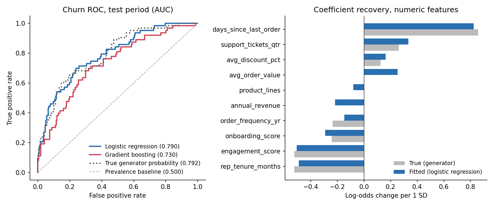

# Medical-Device Sales: Churn Prediction & Revenue Forecasting

Two data-science problems that drive commercial decisions at a B2B medical-device
company, worked end to end in one notebook:

1. **Account churn prediction** — rank accounts by risk of lapsing so the
   commercial team can intervene before revenue is lost.
2. **Revenue forecasting** — project company monthly revenue for planning and
   quota setting.

This mirrors the kind of commercial analytics I ran as Director of Operations &
Business Development, reproduced here on shareable **synthetic** data.

## What's inside

| Part | Technique | Output |
|---|---|---|
| **A — EDA** | grouped comparisons, revenue trend | how churned vs. retained accounts differ |
| **B — Churn model** | Logistic Regression / Random Forest / Gradient Boosting in an `sklearn` `Pipeline` + `ColumnTransformer` | ROC-AUC ≈ 0.81, ROC curves, feature importances, a top-decile retention play |
| **C — Forecasting** | Holt-Winters exponential smoothing (`statsmodels`) | 6-month holdout MAPE ≈ 8.7%, forward forecast |

## Results

- **Churn:** Logistic Regression leads at ROC-AUC ≈ 0.81. By feature importance
  the dominant drivers are order recency, engagement, and rep tenure, with
  discount depth and order frequency contributing modestly. Ranking accounts by
  predicted risk lifts top-decile precision to ~2.5× the base churn rate — the
  same outreach effort reaches far more real churners.
- **Revenue:** Holt-Winters (additive trend + multiplicative seasonality) tracks
  the 6-month holdout within a single-digit MAPE and projects the growth
  trajectory forward.



## Data

All data is **synthetic**, generated with a fixed random seed by
[`generate_data.py`](generate_data.py) — no real company or customer data is used.
The generator fabricates a realistic medical-device sales operation (accounts
across regions/specialties, ordering behavior, support load, latent churn risk)
plus a company-level monthly revenue series with trend and seasonality. It is
committed so the whole analysis is fully reproducible.

```bash
python generate_data.py     # writes data/accounts.csv and data/monthly_revenue.csv
```

## Skills demonstrated

- Business-framed supervised classification with imbalanced-class evaluation
  (ROC-AUC, PR-AUC, threshold-aware precision/recall)
- Model interpretation for action (feature importance → retention play)
- Time-series forecasting with exponential smoothing (trend + seasonality,
  chronological holdout, MAPE/RMSE)
- Translating model output into a concrete commercial decision

## Run it

```bash
pip install -r requirements.txt
python generate_data.py
jupyter lab   # open sales_churn_and_forecasting.ipynb
```
