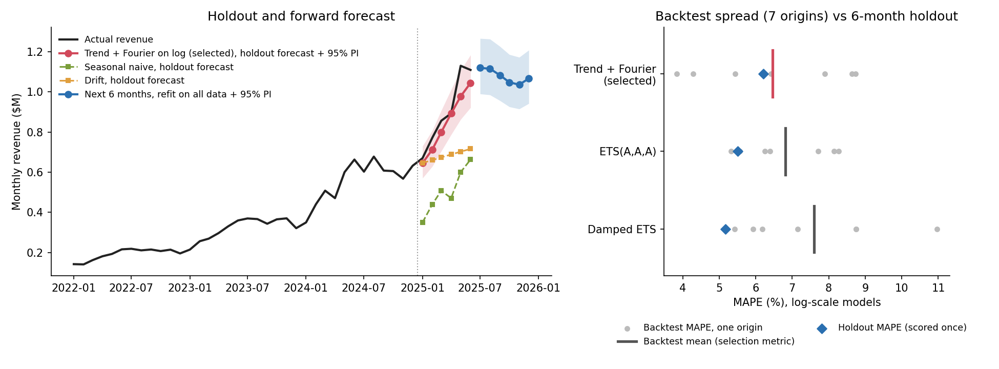

# Medical-Device Sales: Churn Prediction and Revenue Forecasting

Two planning questions for a B2B medical-device business: which accounts are most likely to be lost in the next 90 days, so account managers know where to spend their time, and what monthly revenue to plan for over the next six months. Both are answered on synthetic data with time-ordered validation that mirrors how the models would be used.

## Key results

**Churn** (test period: 280 account snapshots, churn rate 22.5%; 95% bootstrap intervals, 2,000 resamples)

| Model | ROC-AUC (95% CI) | PR-AUC | Brier score | Top-decile precision |
|---|---|---|---|---|
| Prevalence baseline | 0.500 | 0.225 | 0.174 | n/a |
| **Logistic regression (selected)** | **0.790 (0.723 to 0.851)** | **0.577** | **0.136** | **64% (2.9x base rate)** |
| Gradient boosting | 0.730 (0.657 to 0.799) | 0.483 | 0.156 | 50% |
| True generator probability (ceiling) | 0.792 | 0.579 | 0.136 | 64% |

- Logistic regression was selected on validation log loss. On test it essentially matches the true data-generating probability and beats gradient boosting by 0.060 ROC-AUC (paired 95% CI 0.026 to 0.096).
- All seven true churn drivers are recovered with the correct sign. ROC curves and the coefficient comparison are in [figures/roc_curves.png](figures/roc_curves.png).

**Revenue** (6-month holdout, January to June 2025, untouched until a model was selected)

| Method | Backtest MAPE | Holdout MAPE | Holdout 95% PI coverage |
|---|---|---|---|
| Seasonal naive | 42.5% | 44.3% | 0 of 6 |
| Drift | 18.8% | 22.6% | 2 of 6 |
| **Trend + Fourier regression on log (selected)** | **6.5%** | **6.2%** | **5 of 6** |
| SARIMA(0,1,1)(0,1,1)12 on log | 6.7% | 5.9% | 6 of 6 |
| ETS(A,A,A) on log | 6.8% | 5.5% | 5 of 6 |
| Damped-trend ETS on log | 7.6% | 5.2% | 5 of 6 |

The selected model cuts holdout error by more than two thirds against the best baseline. The four log-scale models finish within about one point of each other, a difference six holdout months can't resolve.



## Approach

- **Chronological split with a label embargo.** Account snapshots are split 60/20/20 by date. Because churn is observed 90 days after a snapshot, training rows whose outcome window would still be open at the start of validation are dropped.
- **Logistic regression vs. histogram gradient boosting**, each tuned on the validation period and compared on **log loss**, a proper scoring rule that rewards calibrated probabilities as well as ranking. The test period is scored once.
- **Known-truth benchmark.** Since the generator's churn model is known, its true probabilities give an upper bound on achievable performance, and fitted coefficients can be checked against the true ones.
- **Log-scale forecasting.** Revenue compounds by a percentage each month and its seasonal swing scales with its level, so ETS, SARIMA and a trend + Fourier harmonic regression are fit to log revenue. Additive Holt-Winters on the raw series, used in an earlier version, failed to converge; the same model on log revenue converges.
- **Rolling-origin backtest for model selection.** Seven origins, each forecasting six months ahead within the first 36 months. The lowest-MAPE method among those whose fits all converged is selected, then evaluated once on the final six months.
- **Uncertainty quantification.** Horizon-specific 95% prediction intervals for every method (analytic intervals for the naive baselines) with empirical coverage, and paired bootstrap intervals for the churn model comparison.

## Data

The data are **synthetic**, produced by `generate_data.py` with a fixed seed. No real company, account or customer is represented.

- `data/accounts.csv`: 1,400 account snapshots, one per day from January 2021 to October 2024, with region, specialty, account type, rep tenure, onboarding score, product lines, discounting, support tickets, engagement and ordering behavior (frequency, order value, recency). The 90-day churn outcome is drawn from a logistic model in seven of these features. Overall churn rate: 22.6%.
- `data/monthly_revenue.csv`: 42 months (January 2022 to June 2025) of revenue with 4.5% compounding monthly growth, a 14% seasonal swing peaking in June and 5% multiplicative noise.

## Repository structure

```
├── generate_data.py                    # synthetic data generator (true churn model lives here)
├── churn_model.py                      # temporal split, models, bootstrap, coefficient recovery
├── revenue_forecast.py                 # forecasting methods, rolling-origin backtest, holdout
├── analysis.py                         # runs both analyses, writes metrics/ and figures/
├── sales_churn_and_forecasting.ipynb   # walkthrough with outputs
├── data/                               # generated CSVs
├── metrics/                            # every reported number (JSON and CSV)
├── figures/                            # churn ROC + coefficient recovery, revenue forecast
└── tests/
```

## Reproduce

```bash
python3.12 -m venv .venv && source .venv/bin/activate
pip install -r requirements.txt
python generate_data.py     # rewrites data/ identically
python analysis.py          # about 15 seconds; rewrites metrics/ and figures/
pytest -q
jupyter nbconvert --to notebook --execute --inplace sales_churn_and_forecasting.ipynb
```

## Limitations

- The data are synthetic, and the churn outcome is linear in the log-odds by construction, which favors logistic regression. On real accounts with interactions or thresholds, gradient boosting may win; the same validation protocol would decide.
- The revenue generator is a log-linear trend times a sinusoid, so the trend + Fourier model is close to correctly specified. Real revenue with trend changes or shocks would need the backtest rerun, and damped or local-trend models may do better there.
- The churn test period has 280 snapshots (63 churners), so the confidence intervals are wide. The revenue holdout is six points.
- `annual_revenue` is order frequency times order value, so those coefficients split weight between collinear features and shouldn't be read individually.
- Coefficients describe association in the generator, not the effect of an intervention such as a retention discount.
